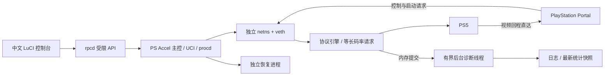

# OpenWrt 主路由版 PS Accel：分析与增强设计

## 结论与基准

采用 OpenWrt 原生 LuCI + Python 协议引擎 + 独立网络命名空间的架构。提码率的有效性以你的 OpenWrt 实机测试为前提，重做方向聚焦管理体验、配置可靠性和部署。

| 项目 | 基准 |
| --- | --- |
| 设备 | FastRhino R66S |
| CPU / 目标平台 | ARMv8 四核 1.8 GHz / rockchip/armv8 |
| 固件 | OpenWrt 25.12-SNAPSHOT，截图标记 11.12.2026 by Xu Guo |
| 内核 | 6.12.115 |
| 主路由地址 | 10.0.0.1 |
| 本地应用 | PS Accel，独立服务与 UCI 配置 |

## 源码依据

审阅 [dy0422/ps5-portal-high-bitrate-openwrt](https://github.com/dy0422/ps5-portal-high-bitrate-openwrt) 的固定提交 [`56f6552`](https://github.com/dy0422/ps5-portal-high-bitrate-openwrt/commit/56f655275ebe941e7bb49f8f69c3f4ac2abe5753)。该仓库沿用 atameric 的协议实现与 MIT 许可，已有中文 LuCI、UCI 配置、procd、独立命名空间、基线测试与恢复进程。

| 模块 | 作用 | 证据 |
| --- | --- | --- |
| `portal_active_probe.py` | 匹配 Takion BIG 启动请求，在 LaunchSpec 推定偏移 334 应用等长 XOR，重算 UDP 校验 | [协议实现](https://github.com/dy0422/ps5-portal-high-bitrate-openwrt/blob/56f655275ebe941e7bb49f8f69c3f4ac2abe5753/portal_active_probe.py#L21) |
| `portal_auto.py` | 单向 Portal→PS5 中继、ARP 引流、恢复 guardian 与新连接计数 | [中继实现](https://github.com/dy0422/ps5-portal-high-bitrate-openwrt/blob/56f655275ebe941e7bb49f8f69c3f4ac2abe5753/portal_auto.py#L147) |
| `openwrt/portal_openwrt.py` | 建立 veth/netns、隔离转发设置、校验基线、管理恢复 | [主控实现](https://github.com/dy0422/ps5-portal-high-bitrate-openwrt/blob/56f655275ebe941e7bb49f8f69c3f4ac2abe5753/openwrt/portal_openwrt.py#L145) |
| `openwrt/portal_luci.py` | LuCI 受限 RPC、后台任务、取消、PID 身份识别 | [管理接口](https://github.com/dy0422/ps5-portal-high-bitrate-openwrt/blob/56f655275ebe941e7bb49f8f69c3f4ac2abe5753/openwrt/portal_luci.py#L117) |

原始上游 37 项离线测试在本机 Python 3.13 / Scapy 2.6.1 下通过。移植的 33 项主控、打包和 LuCI 测试也保留在新版中。

## 主路由架构

主路由的 WAN、NAT、现有转发与防火墙由固件继续管理。中继在独立命名空间内设置转发状态，控制请求经过用户态引擎，视频回程沿用直达路径。

## 增强重点

| 原有行为 | 改造结果 |
| --- | --- |
| 地址与码率共用设备检测入口，档位变化导致重跑测试 | 将码率更新独立为固定 RPC，传输测试绑定设备、网桥与代码 |
| 面板用文件存在表示测试已保存 | 展示当前配置和代码下的真实测试有效性 |
| 固定 65/100/200 档 | 加入 35/45，统一由服务端提供档位元数据 |
| 状态只包含有限计数 | 展示握手修改、控制流采样、平台、恢复状态与日志 |
| stop/卸载请求与恢复进程退出存在时间窗口 | `ps-accel stop` 等待主控与恢复进程完成，再执行卸载或更新 |
| 开机网桥准备较慢时启动失败 | 使用有截止时间的只读网桥就绪检查 |
| 原版发布以 x86 预览为主 | 按 R66S ARM64 主路由提供脚本安装与原生固件构建入口 |
| 所有面板同时展开 | 状态卡常驻，下方 Tab 切换串流控制、设备配置与日志诊断 |
| 保存码率需要手动停止、保存再启动 | LuCI 串行完成恢复、换档与重启，启动失败时尝试回退 |
| 日志与状态写入发生在转发循环 | 有界后台线程处理写入，进程身份与本次启动就绪标记独立判断运行状态 |

35/45 的 XOR 从 `25000` 到 `35000` / `45000` 计算。65/100/200 沿用原请求 `65000` / `1e+05` / `2e+05`；协议报文字段长度保持一致。

0.1.0 基础版本已保留为独立安装包。0.1.1 在此基础上加入三项优化。诊断线程采用 128 条事件队列、最新快照覆盖与 1 MiB 日志轮转，写入异常计入诊断健康信息；恢复进程先释放恢复标记与引擎锁，再通过后台线程记录报告。必要控制凭据保存失败时，启动流程终止已创建的中继进程。

当前 110 项测试覆盖协议请求、主路由隔离、管理任务、日志写入失败与阻塞、恢复报告隔离、自动换档与回退、PID 身份与启动标记、包完整性和模拟部署。页面预览完成桌面、手机和窄屏 Tab、自动重启提示、深浅色与诊断健康展示验证。

## 社区补丁与扩展边界

[Issue #1 的 iStoreOS 实机记录](https://github.com/dy0422/ps5-portal-high-bitrate-openwrt/issues/1) 报告了双向引流、内核视频快路径、主路由 ARP 守卫与重复实例问题。该记录来自 x86_64 / iStoreOS 24.10 / Linux 6.6 场景，可作为后续兼容模式的证据。

当前基准采用你已验证的原链路。双向模式可以作为独立传输后端加入，并保留代码指纹、设备绑定、互斥运行、网络恢复和主路由邻居表保护。

工作区已有 `PS-Portal-Relay` 的 HTTP CONNECT 登录与信令代理。该模块可与局域网提码率引擎协作：代理负责 Sony 登录/发现请求，主路由引擎负责本地串流启动请求。

## 部署验收

按同一移动画面分别比较 35/45/65/100 档，记录 Portal 显示、按键体验、实际吞吐和主路由 CPU；目标请求与流量测量分别记录。检查主路由冷启动、新连接、运行中自动换档、开机启动偏好、停止恢复、与原插件互斥和安装/卸载。

建议以 R66S 的稳定档位完成部署验收，再逐档提高目标码率。
